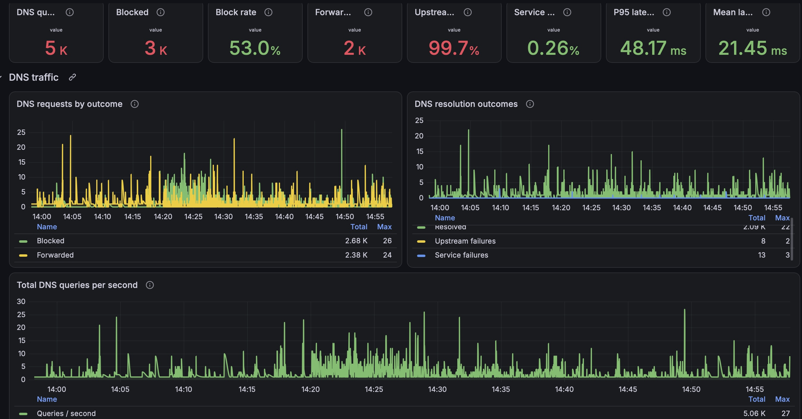
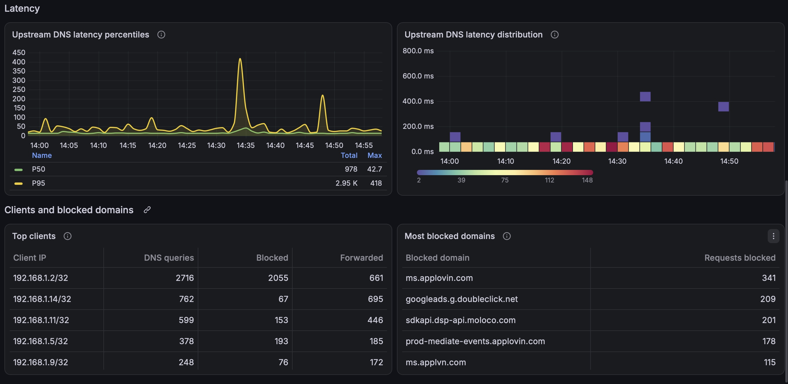
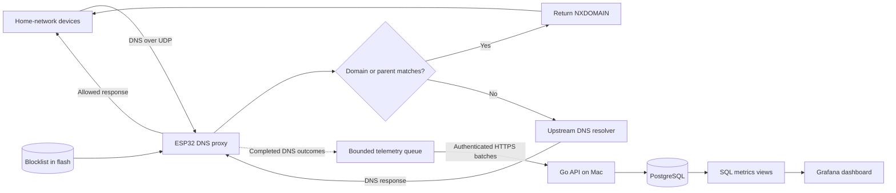
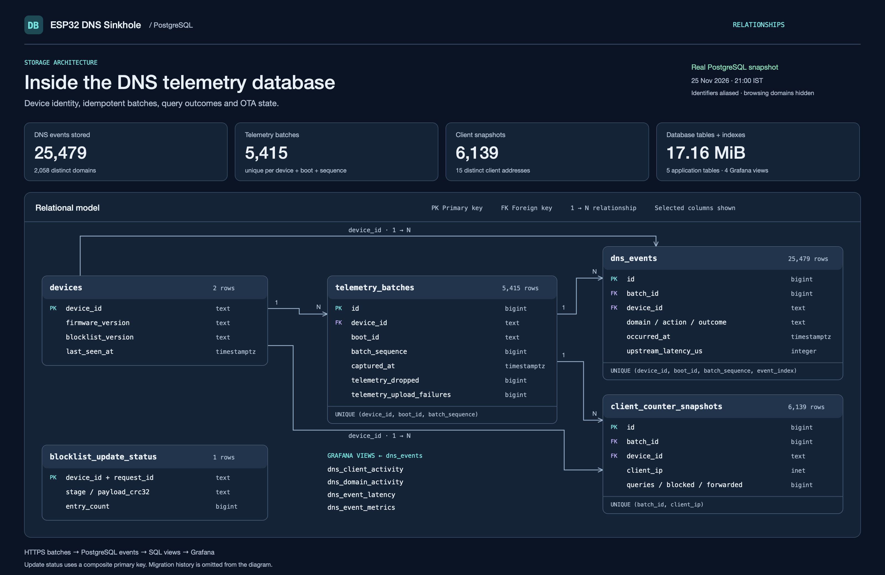
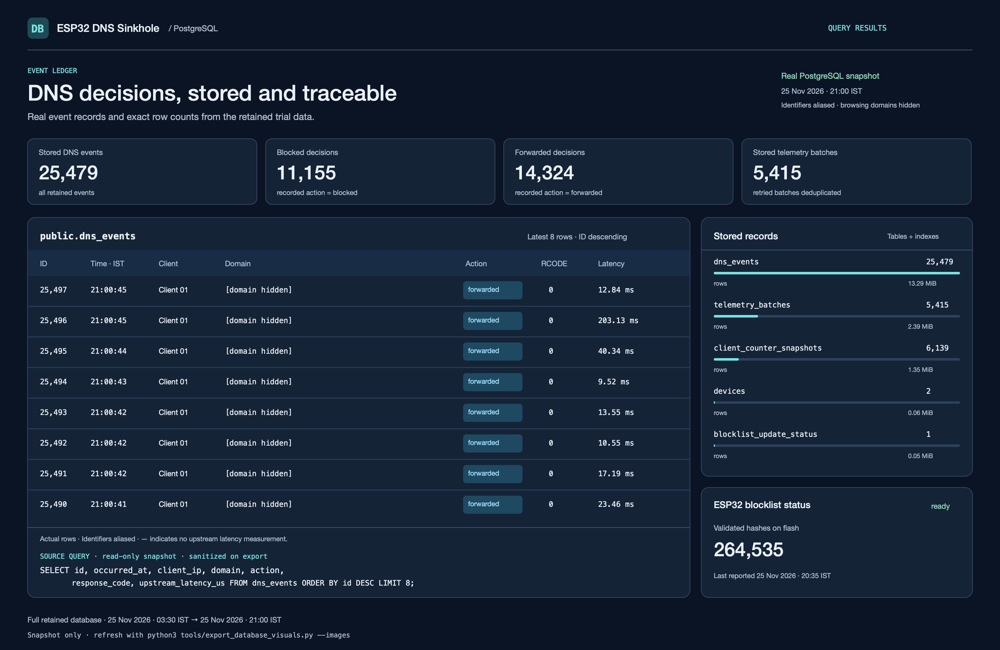
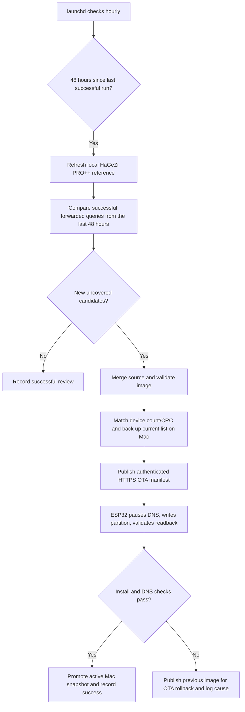

<div align="center">

# ESP32 DNS Sinkhole

**Network DNS filtering on an ESP32, with a Go API, PostgreSQL telemetry, and Grafana observability.**


**Home-network prototype · Trial 1 · Firmware 0.2.1**

[Working model](#working-model) · [Trial results](#trial-results) · [Database](#database) · [Setup](#setup) · [Operations](#operations)

</div>

An ESP32 receives DNS requests from devices on the home network, checks a compact blocklist stored in flash, and forwards allowed requests to an upstream resolver. A separate telemetry worker sends query outcomes to a Go HTTPS API. PostgreSQL stores the events and Grafana visualizes traffic, failures, clients, and upstream latency.

The Mac also runs a scheduled blocklist workflow. Every 48 hours, it compares successful forwarded queries against HaGeZi Multi PRO++, builds additions, validates and backs up the list, and delivers changes to the ESP32 over HTTPS OTA.

## At a glance

| Component | Implementation |
| --- | --- |
| DNS filtering | Local lookup against **264,535** sorted 40-bit hashes in flash |
| DNS forwarding | Asynchronous UDP forwarding with **32** pending request slots |
| Telemetry | **128** queued events, batches of up to **32**, approximately **1-second** flush interval |
| API | Go, certificate-verified HTTPS, bearer authentication, idempotent batch ingestion |
| Database | **5 application tables**, **5 foreign keys**, **4 Grafana views** |
| Firmware updates | Password-authenticated Arduino OTA over the LAN |
| Blocklist updates | HTTPS data-partition OTA with SHA-256, CRC32, ordering, and readback checks |
| Scheduling | macOS `launchd`, hourly checks, **48-hour** review interval |
| Recovery | Previous blocklist backed up on the Mac and republished for OTA rollback on failure |

## Trial results

The first main-router trial ran for over an hour on **25 November 2026**. The figures below are observations from that trial and the retained database, with their scopes stated explicitly.

### Main-router dashboard



| Metric | Captured one-hour dashboard window |
| --- | ---: |
| DNS queries | Approximately **5.06K** |
| Blocked queries | Approximately **2.68K** |
| Forwarded queries | Approximately **2.38K** |
| Block rate | **53.0%** |
| Upstream success | **99.7%** |
| Service failure rate | **0.26%** |
| Mean upstream latency | **21.45 ms** |
| P95 upstream latency | **48.17 ms** |

These rounded values come from the captured dashboard. Block rate varies with client traffic. Upstream latency measures forwarded DNS responses, and excludes local block responses.

<details>
<summary><strong>View latency distribution, clients, and blocked domains</strong></summary>



</details>

### Retained database snapshot

Captured **25 November 2026 at 21:00 IST**, covering retained events from approximately 03:30 to 21:00 IST, including earlier trials.

| Stored data | Count |
| --- | ---: |
| DNS event rows | **25,479** |
| Blocked decisions | **11,155** |
| Forwarded decisions | **14,324** |
| Distinct queried domains | **2,058** |
| Distinct client addresses | **15** |
| Telemetry batches | **5,415** |
| Client counter snapshots | **6,139** |
| Application tables and migration history, including indexes | **17.16 MiB** |

The database snapshot and one-hour dashboard cover different windows. Historical telemetry losses are reflected in the retained dataset. Counts describe recorded activity and are not a sustained-capacity benchmark.

## Working model



1. **Receive and parse.** The ESP32 parses the question and normalizes the domain.
2. **Check locally.** It hashes the domain and parent suffixes and binary-searches the sorted flash list.
3. **Block or forward.** Matches receive NXDOMAIN. Allowed requests use a bounded pending-request slot, with transaction IDs mapped back to the original client.
4. **Record the outcome.** Events distinguish successful blocks, upstream responses, timeouts, queue exhaustion, and send errors.
5. **Upload asynchronously.** A worker batches events and retries failed uploads with the same batch identity. Database uniqueness constraints deduplicate retries.
6. **Visualize.** Grafana reads PostgreSQL views for counts, outcomes, client activity, and measured upstream latency.

DNS decisions run on the ESP32. The API and database process telemetry independently, so backend outages can fill the event queue while DNS continues operating. Full queues increment a telemetry-drop counter.

### Telemetry memory management

Firmware `0.2.1` addresses the TLS allocation failures encountered during the trial. The event pool uses aligned 32-bit memory accesses, FreeRTOS queues carry slot indices, and JSON capacity scales with batch size. Uploads avoid an extra payload copy. A shared HTTPS mutex serializes telemetry and blocklist requests, and failure logs include the largest free internal memory block.

After the fix was deployed over Wi-Fi, the recovery check recorded **12 consecutive batches, 33 queries, and zero reported telemetry drops or upload failures over 40 seconds**. Longer sustained-load validation remains pending.

## Database

### Schema and relationships



| Table | Role |
| --- | --- |
| `devices` | Device identity, firmware metadata, and first/last seen times |
| `telemetry_batches` | Batch counters and delivery health, unique by device, boot, and sequence |
| `dns_events` | Per-query decisions, response outcomes, client, domain, and latency |
| `client_counter_snapshots` | Per-client query, block, forward, and failure counts within a batch |
| `blocklist_update_status` | Current-list and OTA stage reports keyed by device and update request |

The four Grafana views are `dns_event_metrics`, `dns_event_latency`, `dns_client_activity`, and `dns_domain_activity`. The metrics view groups events into one-second buckets. The latency view retains individual upstream-response measurements for percentile calculations.

### Event records and storage



The [database explorer](docs/database/README.md) includes a browser view, sanitized snapshot, source SQL, and reusable PNG exporter. Device identifiers and client addresses are omitted from the exported rows. Forwarded browsing domains are hidden except the `example.com` and `example.org` probes. Blocked-domain names remain visible.

## Automated blocklist lifecycle



| Stage | Checks and behavior |
| --- | --- |
| Review | Selects forwarded events with an upstream `NOERROR` response. Unmatchable names are reported. |
| Candidate selection | Matches the reference with parent-domain coverage and excludes domains covered by the installed source. |
| Build | Preserves installed domains, checks collisions and strict hash order, and computes CRC32 and SHA-256. |
| Preflight | Confirms partition capacity and matches the Mac backup against the ESP32's reported count and CRC. |
| Install | Downloads over verified HTTPS, pauses DNS, writes the data partition, and validates the installed list. |
| Confirm | Checks that a candidate becomes blocked and an existing blocked domain still blocks. |
| Recover | Publishes the saved Mac image for rollback and records the failure cause. Failed runs retry after six hours. |

The scheduler is a macOS login agent. The Mac must be awake, logged in, and connected to the LAN, with PostgreSQL running. The updater can start the Go API when it is unavailable. An overdue run is picked up on a later scheduler invocation. No-candidate reviews complete without a flash write.

**Validation status.** Reference comparison, a no-candidate scheduled workflow, firmware OTA, telemetry recovery, and DNS resolution/blocking have been observed on the trial hardware. The candidate-changing blocklist install and induced-failure rollback paths are implemented and still need a controlled end-to-end hardware trial.

## Hardware and flash budget

| Item | Trial configuration |
| --- | --- |
| Board | ESP32-D0WD-V3, 4 MiB flash, no detected PSRAM |
| Flash settings | DIO, **40 MHz**, custom partition table |
| Firmware | `0.2.1`, approximately **1.21 MB** application image |
| Application slots | Two slots of **1,310,720 bytes** each |
| Blocklist partition | **1,441,792 bytes** |
| Installed blocklist image | **1,322,691 bytes**, including its 16-byte header |
| Blocklist entries | **264,535** |
| Space remaining in blocklist partition | **119,101 bytes**, or **23,820** additional five-byte hashes |
| Collisions in the included source build | **0** |

The [build manifest](outputs/pro-plus-fnv40.manifest.json) records source provenance, format, checksums, and capacity. The blocklist uses five-byte FNV-1a-derived hashes instead of full domain strings in flash. Binary search and parent-suffix matching keep lookup memory bounded. See [design decisions](DESIGN.md).

## Setup

### Requirements

| Layer | Requirements |
| --- | --- |
| Firmware | Arduino IDE 2 or Arduino CLI, Espressif ESP32 board package, the project's `partitions.csv` |
| Backend | Go **1.25+**, PostgreSQL **14+**, local CA and server certificate |
| Automation | macOS, Python **3.10+**, Go available in the scheduler's PATH |
| Observability | Grafana with its PostgreSQL datasource |
| Image export | `psql` and Swift from the macOS command line tools |

### Configure and start

1. **Prepare the board.** Open `firmware/ESP32DnsSinkhole/`, select the custom partition table, and set 4 MB flash, DIO, and 40 MHz. Initial provisioning of a fresh board requires a bootstrap flash. Once its OTA service and partition table are installed, use the network OTA service for subsequent firmware uploads.
2. **Configure local secrets.** Copy `firmware/ESP32DnsSinkhole/secrets.example.h` to `secrets.h`. Set Wi-Fi credentials, the OTA password, API URL/token, and blocklist version. Put the local CA certificate in `telemetry_ca.h`.
3. **Configure the API.** Follow [backend setup](backend/README.md) to create the database, configure `backend/.env.local`, and issue a server certificate with the Mac's reserved LAN address in its IP SAN.
4. **Start the API.** From the repository root, use the command below.
5. **Upload firmware over Wi-Fi.** Choose the `esp32-dns-sinkhole` network port. Confirm `Blocklist OTA worker started` and successful telemetry batches in Serial Monitor.
6. **Configure Grafana.** Follow [dashboard provisioning](backend/grafana/README.md).
7. **Enable the schedule.** Run the installer in the operations table below.
8. **Connect test clients.** Reserve the ESP32's LAN address and set it as the clients' DNS server. For network-wide use, configure the router's DHCP DNS advertisement and account for IPv6 DNS advertisements and clients that use encrypted DNS.

```sh
cd backend
set -a
source .env.local
set +a
go run ./cmd/server
```

### Check DNS

Replace `ESP32_LAN_IP` with the ESP32's address before running these commands.

```sh
nslookup example.com ESP32_LAN_IP
nslookup googleads.g.doubleclick.net ESP32_LAN_IP
```

On the trial list, `example.com` returned upstream answers and `googleads.g.doubleclick.net` returned NXDOMAIN. Serial Monitor commands include `stats`, `telemetry`, `resolver`, and `help`.

## Operations

Run these commands from the repository root unless a directory change is shown.

| Task | Command |
| --- | --- |
| Install the 48-hour schedule | `python3 tools/install_blocklist_automation.py --install` |
| Run a complete update cycle now | `python3 tools/update_blocklist.py --force` |
| Review and validate without deployment | `python3 tools/update_blocklist.py --dry-run` |
| Remove the schedule | `python3 tools/install_blocklist_automation.py --uninstall` |
| Watch updater results | `tail -f outputs/logs/automatic-blocklist-update.log` |
| Inspect the saved run state | `cat outputs/runtime/blocklist-automation-state.json` |
| Refresh the database explorer and PNGs | `python3 tools/export_database_visuals.py --images` |

| Log message | Meaning |
| --- | --- |
| `OTA update complete; new blocklist is active and verified` | Installation and DNS verification succeeded. |
| `Review completed: no new candidates; no OTA flash was needed` | Review succeeded with no list additions. |
| `Rollback confirmed: previous list is restored and DNS filtering is active` | The attempted update failed and the previous list was restored. |

Runtime reports, raw query reviews, backups, logs, and local credentials are excluded from Git. The database figures are sanitized, timestamped exports prepared for sharing.

## Repository map

```text
firmware/ESP32DnsSinkhole/   DNS proxy, flash reader, telemetry and OTA workers
backend/cmd/server/        HTTPS telemetry and blocklist API
backend/cmd/review-blocklist/  Successful-query comparison against reference feeds
backend/internal/store/    PostgreSQL migrations and persistence
backend/grafana/           Dashboard JSON and datasource provisioning
tools/                     Image builder, updater, scheduler and visual exporters
outputs/                   Included blocklist source, binary and build manifest
docs/database/             Database diagram, row snapshot and browser explorer
docs/screenshots/          Captured Grafana trial dashboards
DESIGN.md                  Storage, concurrency, telemetry and recovery decisions
```

## Constraints and next validation

- DNS transport currently uses UDP over the IPv4 LAN. DNS-over-TCP fallback remains future work.
- The bounded telemetry queue is volatile. Backend outages or sustained bursts can drop event records, and counters report those losses.
- Firmware and blocklist writes pause DNS. A failed blocklist update relies on the Mac and working networking to complete rollback because only one list is stored on the ESP32.
- Blocklist filtering applies to domain names. Ads served from domains shared with application content can remain visible.
- Reference comparison considers successful forwarded `NOERROR` responses within the selected window. It cannot recover queries lost from telemetry.
- Next hardware checks include sustained router traffic, candidate-changing OTA, deliberate update interruption, rollback, and post-recovery DNS checks.

## Data handling and attribution

The API uses bearer authentication and a private CA trust root. Firmware OTA uses a separate password and the Arduino LAN transport. Keep these services on a trusted network. Local configuration, tokens, CA/server private keys, and raw browsing records belong outside version control.

The original Grafana captures contain local client addresses and queried domains. The database exports alias clients and hide forwarded browsing domains. Review image contents before using them in a public post.

Blocklist data comes from [HaGeZi DNS Blocklists](https://github.com/hagezi/dns-blocklists), specifically the Multi PRO++ domains-only feed. The included manifest records the source URL and version. Consult the upstream license and attribution terms when redistributing those datasets.

More detail is available in the [backend guide](backend/README.md), [Grafana guide](backend/grafana/README.md), [database visuals guide](docs/database/README.md), and [sanitized Serial Monitor excerpt](docs/serial-monitor-session.txt).
