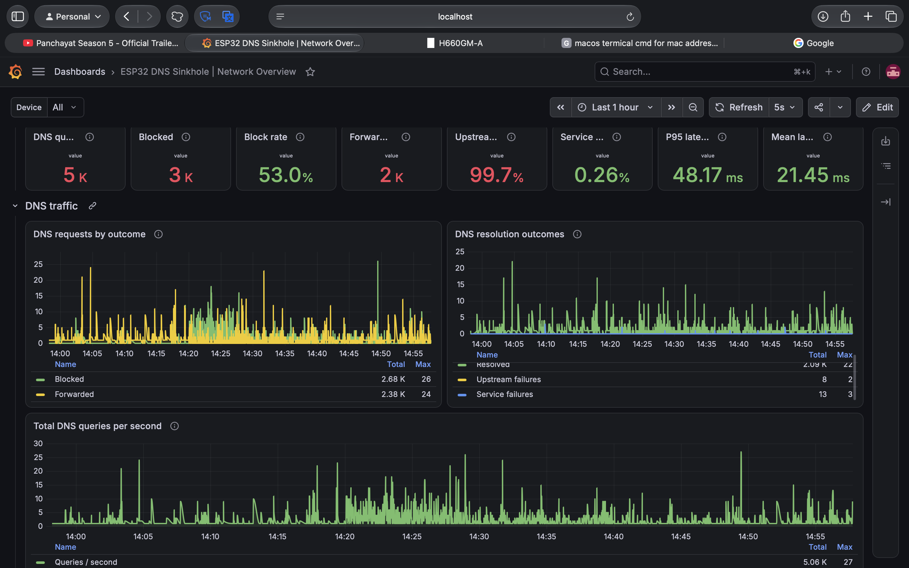
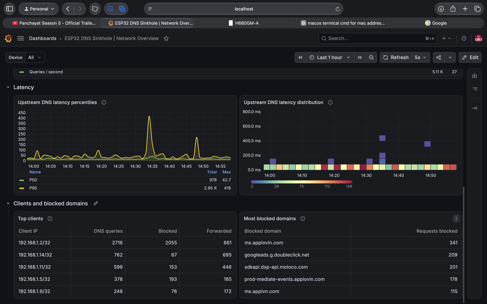

# ESP32 DNS Sinkhole

An ESP32-based DNS sinkhole with a locally stored compact blocklist, asynchronous upstream DNS forwarding, firmware OTA, and a Go/PostgreSQL/Grafana telemetry stack.

## Highlights

- Local DNS filtering uses sorted 40-bit domain hashes stored in flash. The ESP32 binary-searches the list and checks parent suffixes, so a blocked parent domain also covers its subdomains.
- DNS forwarding uses a nonblocking request/response state machine. Resolver address and port are configurable and persisted in NVS.
- DNS decisions stay on the ESP32. A bounded queue and low-priority worker send authenticated HTTPS telemetry to the Mac; telemetry outages do not stop DNS handling.
- Firmware OTA and raw blocklist updates are separate. The project partition table reserves two app slots and a dedicated blocklist partition.
- The Go API ingests idempotent event batches into PostgreSQL. Grafana dashboards show DNS outcomes, block rates, failures, client summaries, and upstream latency.

## Trial dashboard





These real trial screenshots include local client addresses and queried-domain telemetry. Keep this repository private unless you replace them with sanitized captures.

The sanitized Serial Monitor session excerpt is in [`docs/serial-monitor-session.txt`](docs/serial-monitor-session.txt). A Serial Monitor screenshot still needs to be added; the current desktop capture interface did not produce an image file.

## Repository layout

- `firmware/ESP32DnsSinkhole/` — Arduino sketch, DNS proxy, telemetry client, and custom partition table.
- `backend/` — Go HTTPS API, PostgreSQL migrations, blocklist review command, and Grafana provisioning/dashboard JSON.
- `tools/` — host-side blocklist builder and guarded flash utility.
- `outputs/` — current compiled blocklist and the selected HaGeZi source/baseline snapshots.
- `docs/` — design notes and trial evidence.

## Quick start

1. Install Arduino IDE 2 and the Espressif ESP32 board package. Open `firmware/ESP32DnsSinkhole/` as a sketch and select the project's `partitions.csv` as the custom partition table.
2. Copy `secrets.example.h` to `secrets.h`, then set Wi-Fi details, a unique OTA password, the API URL, and a random API token. Generate a local CA and server certificate; put the CA certificate in `telemetry_ca.h`. Keep these local configuration files and private keys out of Git.
3. Set up PostgreSQL and the Go API using [`backend/README.md`](backend/README.md). Bind the API to the Mac's reserved LAN address and generate a TLS certificate whose IP SAN matches that address.
4. Build and validate the firmware. Flash the blocklist partition once over USB with `tools/flash_blocklist.py`; do not erase all flash or switch to a stock partition layout.
5. Upload the OTA-enabled firmware once over USB. Later firmware updates can use Arduino IDE's network port. Check Serial Monitor for `Blocklist ready`, `Arduino OTA service started`, and accepted telemetry batches.
6. Import the dashboard using [`backend/grafana/README.md`](backend/grafana/README.md).

The initial device build used an ESP32-D0WD-V3 with 4 MiB flash and no detected PSRAM. The installed HaGeZi Multi PRO++ snapshot contains 264,535 sorted hashes. The compiled firmware and blocklist manifest are included under `outputs/` for reproducibility.

## Build a blocklist image

The checked-in source snapshot is `outputs/hagezi-pro-plus-onlydomains.txt`. It is derived from [HaGeZi DNS blocklists](https://github.com/hagezi/dns-blocklists); review its upstream license and notices before redistributing the source or binary publicly.

```sh
python3 tools/build_blocklist.py
python3 tools/flash_blocklist.py  # validation/dry run
```

To write the list, provide the ESP32 serial port and the script's explicit confirmation:

```sh
python3 tools/flash_blocklist.py --port /dev/cu.YOUR_ESP32_PORT --flash
```

The flasher validates the image header, CRC, manifest SHA-256, partition capacity, and sector padding before writing only the blocklist partition. Keep the previous working blocklist backup on the Mac before replacing it.

## Privacy and security

- `secrets.h`, `telemetry_ca.h`, `.env.local`, local TLS keys, database contents, and generated DNS review reports are intentionally excluded from Git.
- DNS telemetry includes queried names and client IPs. Keep the API and database on a trusted LAN, set a retention policy, and do not port-forward the API.
- The dashboard screenshot is retained only in this private repository. Replace it with a redacted screenshot before changing repository visibility.
- Arduino OTA is password-authenticated but not encrypted; use it only on a trusted home network. HTTPS protects telemetry in transit.

See [`DESIGN.md`](DESIGN.md) for storage, lookup, forwarding, and update decisions.
