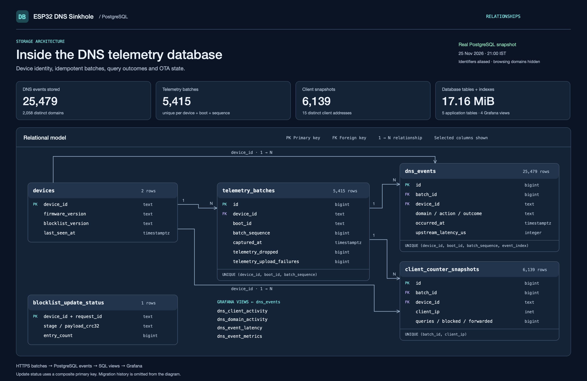
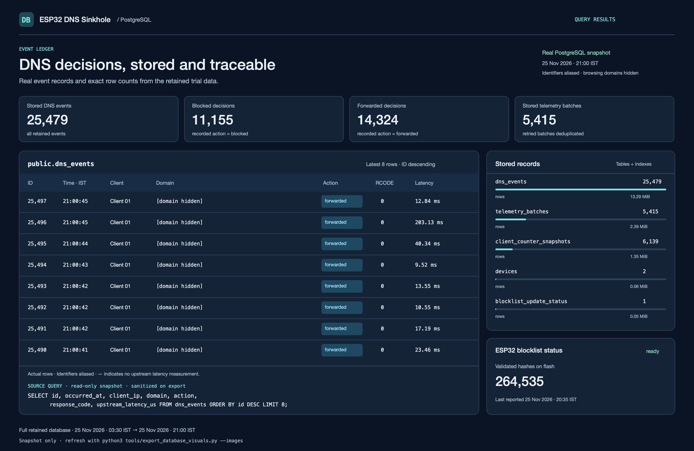

# Database visuals

These figures come from a real, consistent PostgreSQL snapshot. The explorer has **Relationships** and **Query results** tabs. Open `index.html` in a browser or serve this directory locally.





The diagram shows selected columns, every declared application foreign key and the four Grafana views. `blocklist_update_status` uses an independent composite primary key. The displayed disk size includes table data, indexes and migration history. Event totals cover all retained records, including earlier firmware trials and any telemetry gaps.

The event ledger uses actual rows with client addresses replaced by stable ordinal aliases. Forwarded browsing domains are hidden, except the example.com and example.org probes. Blocked domain names remain visible. Counts and DNS outcomes are preserved. These files are static exports, and their capture time appears on each figure.

Refresh the explorer and both images from the repository root on macOS:

```sh
python3 tools/export_database_visuals.py --images
```

This requires the project's local PostgreSQL configuration, `psql`, and Swift from the Xcode command line tools. The exporter uses a read-only repeatable-read transaction. It writes sanitized data to `snapshot.json`, refreshes `index.html`, and exports PNGs at 3200 × 2080 pixels.

To refresh just the browser explorer:

```sh
python3 tools/export_database_visuals.py
```

The underlying SQL is in `snapshot.sql`. For a LinkedIn post, upload either PNG directly. For GitHub, embed the images using the relative paths above.
